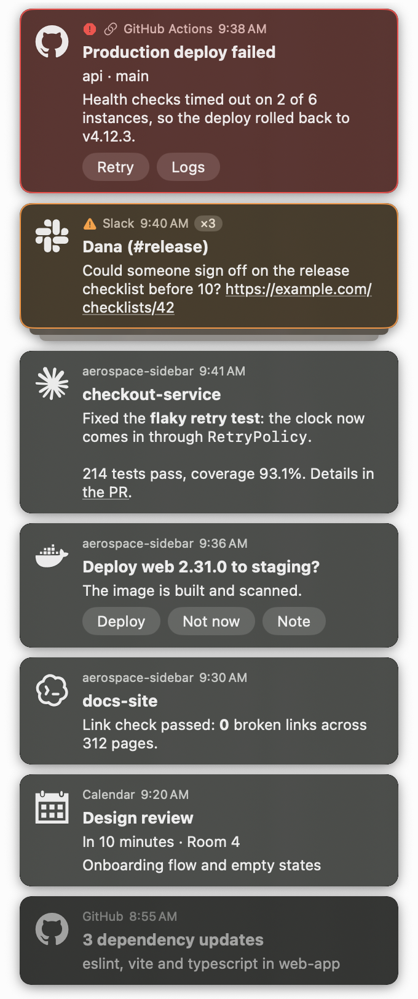

`aerospace-sidebar` is a permanent notification sidebar for macOS users of the [AeroSpace](https://github.com/nikitabobko/AeroSpace) tiling window manager. It takes over one edge of the main display, replaces macOS notification banners with a list that stays until you deal with it, and lets scripts, agents and web pages push their own notifications, or ask you a question and wait for the answer.

<a href="docs/screenshot/sidebar.png"></a>

# What It Does

- **Reserved screen strip**: a panel on the right or left edge of the main display that tiled windows never cover, on every Space and over full-screen apps.
- **macOS notifications, kept**: banners are hidden and listed as cards until you deal with them. Clicking a card does what clicking the notification would.
- **Notification buttons on cards**: Reply, Approve, Delete and other buttons apps put on their notifications work from the card, even after the banner has timed out.
- **Missed notifications**: notifications that never showed a banner (Focus, Do Not Disturb, banner style None, or sent while the sidebar was not running) are listed too.
- **Push from anywhere**: the `aerospace-sidebar` command and `aerospace-sidebar://` links add notifications with click actions, up to eight buttons, markdown and app icons.
- **Ask and wait**: `aerospace-sidebar notification ask` waits until you pick a button or type a reply and prints your answer, so a script or agent can ask you something.
- **Severity and rules**: `low`, `normal`, `high` and `critical` cards sort and look different; regular-expression rules raise, lower or hide notifications by sender, title, subtitle or body.
- **Stacking**: a repeat of a listed notification, or a push with the same `--key`, joins its card and shows a count instead of adding a copy.
- **History**: the list survives relaunching, keeping notifications for 24 hours by default.
- **Guided setup**: Settings grants the permissions, adds the login item and updates your AeroSpace config, one button each.

# How It Works

1. AeroSpace leaves an empty strip on one edge of the main display, and the sidebar fills it.
2. When an app posts a macOS notification, its banner vanishes and a card appears at the top of its severity group.
3. `aerospace-sidebar notification push` adds a card from the terminal, starting the sidebar when it is not running. `notification ask` also waits for your answer.
4. Clicking a card runs its action, or opens the notification in the app that posted it, and removes the card. Option-click, or the × that appears on hover, removes it without acting.
5. A card's buttons do what they say and remove the card. A button that asks for text opens a field; Return sends it.

# How it Really Works

### AeroSpace

- The sidebar's side and width come from `[sidebar]` in its `config.toml`. It keeps a managed block in AeroSpace's `[gaps]` table, between `# >>> aerospace-sidebar` and `# <<< aerospace-sidebar <<<`, that reserves the same strip on `monitor.main` and keeps your other monitors' entries.
- It rewrites that block and reloads AeroSpace at launch, whenever the AeroSpace config changes, and whenever you change the side or width. It never creates a missing AeroSpace config.
- Each edit saves the previous config as `aerospace.toml.bak` and is checked with `aerospace reload-config --dry-run`; an edit that adds a problem AeroSpace reports is undone. **Update Config** and **Write Again** in Settings › Sidebar run the edit on demand.
- A generated AeroSpace config is repaired after each regeneration. To avoid the round trip, keep the block in the generator's source.

### macOS notifications

- The sidebar reads notifications from Notification Center through the Accessibility API and hides banners by moving Notification Center's window off-screen. Quitting the sidebar moves the window back.
- A hidden notification stays open until its card goes, so the card can still open it or press its buttons, also after a banner times out into Notification Center's history. Doing that from the history opens the history panel off-screen, which can flash for a few frames as it closes.
- What a notification's buttons are (titles, text fields, destructive ones) comes from macOS's notification database (`~/Library/Group Containers/group.com.apple.usernoted/db2/db`, read-only), which needs Full Disk Access. The same database lists the notifications no banner showed. It is private to macOS and may change with an update; the sidebar then logs the error and keeps intercepting banners.
- Without Full Disk Access, only alerts with one or two buttons keep theirs on the card.
- A notification whose buttons a card cannot offer, such as a text field or buttons its app never declared, stays on screen as macOS shows it and is listed too. On a right-hand sidebar, macOS's notifications move left of it. Set `actionable_left_to_macos = false` to hide these and list them without their buttons.
- macOS's question whether an app may send notifications is never touched: closing it would answer Don't Allow.
- Notifications from apps switched off in System Settings › Notifications are recorded but never shown by macOS. The sidebar lists them only with `list_switched_off_apps = true`, and Settings › Notifications names these apps with an **Allow** button.

### Pushed notifications

- The command talks to the app over a socket only your account can open, `$(getconf DARWIN_USER_TEMP_DIR)com.alexgorbatchev.aerospace-sidebar.sock`. Only this path can attach commands or text fields.
- `aerospace-sidebar://` links can be opened by any app, and by web pages after your browser asks. They never carry commands, text fields or questions, and their links must be `http` or `https`.
- Commands run in your login shell (`-lc`) in the directory where you ran `aerospace-sidebar`, with output discarded. A button's command gets the button's title in `AEROSPACE_SIDEBAR_CHOICE` and the text you sent in `AEROSPACE_SIDEBAR_REPLY`, never inside the command itself, so quote it like any variable.
- A question's card goes when its command stops waiting (Ctrl-C or `--timeout`). Quitting the sidebar ends a waiting command with `no_answer`.
- Icons come from [sketchybar-app-font](https://github.com/kvndrsslr/sketchybar-app-font), bundled with the app. An unknown id leaves the card without an icon and adds an `Invalid icon: <id>` note; [`icon_map.json`](Resources/sketchybar-app-font/icon_map.json) lists every id.

### Files

- The list: `~/Library/Application Support/com.alexgorbatchev.aerospace-sidebar/notifications.json`, at most 200 cards by default (a stack counts as one). `received.json` beside it keeps every notification received, also dismissed or hidden ones, for testing rules in Settings › Rules.
- Settings: `${XDG_CONFIG_HOME:-~/.config}/aerospace-sidebar/config.toml`. Edits apply immediately. Saving from Settings rewrites it without comments; a symlinked file stays a symlink.

### Output and exit codes

Answers and success messages go to stdout, errors to stderr. With `AGENT=1` the output is one compact line: `OK: pushed`, `OK: ` and the answer as JSON, or `ERR: <code>: <detail>`.

| Code | Meaning |
| :--- | :--- |
| `0` | Success |
| `1` | Notification invalid, undeliverable or not confirmed, or the app stopped waiting for an answer (`no_answer`) |
| `2` | A question got no answer: its card went, or `--timeout` passed |
| `64` | Invalid arguments |
| `74` | Output could not be written |

`no_reply` means a notification was sent but not confirmed in time. It may still appear, so do not send it again; an unconfirmed question leaves no card and can be asked again.

# Installation

Download the app for macOS (Apple Silicon) from the [latest release](https://github.com/alexgorbatchev/aerospace-sidebar/releases/latest) and link the `aerospace-sidebar` command it carries onto your `PATH`:

```bash
version=$(curl -sSI https://github.com/alexgorbatchev/aerospace-sidebar/releases/latest | sed -n 's|^location: .*/tag/v\(.*\)\r$|\1|ip')
mkdir -p ~/Applications ~/.local/bin
curl -sSL "https://github.com/alexgorbatchev/aerospace-sidebar/releases/download/v$version/AerospaceSidebar_${version}_darwin_arm64.tar.gz" | tar -xz -C ~/Applications
ln -sf ~/Applications/AerospaceSidebar.app/Contents/Helpers/aerospace-sidebar ~/.local/bin/aerospace-sidebar
```

Run the same commands to update. Each release also has the command on its own as `aerospace-sidebar_<version>_darwin_arm64.tar.gz`.

# Setup

1. Open `~/Applications/AerospaceSidebar.app`.
2. Click the gear button at the bottom of the sidebar to open Settings.
3. Under **Sidebar**, pick the side and width (300 points on the right by default) and check that the AeroSpace config shows as updated.
4. Under **Permissions**, grant Accessibility, optionally grant Full Disk Access, and add the login item. The permission steps open the right System Settings page with a panel to drag the app from.
5. Quit other apps that restyle or hide notification banners, such as NotifyMeHow.

What each permission is for:

- **Accessibility** (required): reads and hides macOS notifications.
- **Full Disk Access** (optional): buttons on banners, notifications that showed no banner, and apps with notifications switched off.
- **Login item**: opens the sidebar at login; needs the app in `~/Applications` or `/Applications`.

Release builds are not signed with a developer certificate, so after each update, click **Remove** next to each permission and grant it again.

To configure AeroSpace by hand, **Copy Settings** in Settings › Sidebar copies this, then run `aerospace reload-config`:

```toml
[gaps]
# >>> aerospace-sidebar: managed block, rewritten when the sidebar's side or width changes >>>
outer.left = 5
outer.right = [{ monitor.main = 305 }, 5]   # sidebar width + the fallback gap
# <<< aerospace-sidebar <<<

[[on-window-detected]]
if = 'test %{app-bundle-id} = com.alexgorbatchev.aerospace-sidebar'
run = 'layout floating'
```

Bind fullscreen as `fullscreen`, not `fullscreen --no-outer-gaps`, or fullscreen windows cover the sidebar.

# Quick Start

```bash
# Show a notification with the Ghostty icon
aerospace-sidebar notification push --icon ghostty --title "Tests passed" --body "142 passed in 31s"

# A critical notification that reopens the CI run when clicked
aerospace-sidebar notification push --severity critical --title "Deploy failed" --run "open https://ci.example.com/runs/42"

# Buttons that run a command, or send what you type to one
aerospace-sidebar notification push --title "Release ready" --choice "Tag it=git tag v1.2.0" --reply 'Note=echo "$AEROSPACE_SIDEBAR_REPLY" >> notes.txt'

# Ask a question and print the button you pick
aerospace-sidebar notification ask --title "Deploy to production?" --choice Deploy --choice Wait

# A link that shows a notification when opened, for web pages, Shortcuts or Raycast
aerospace-sidebar notification url --title "Backup finished" --severity low

# Install the agent skill
aerospace-sidebar skill
```

Sample Output:
```
[OK] Notification sent to the sidebar.
[OK] Notification sent to the sidebar.
[OK] Notification sent to the sidebar.
Deploy
aerospace-sidebar://notification/push?title=Backup%20finished&severity=low
Install the aerospace-sidebar skill using the Skills CLI:

  npx skills add alexgorbatchev/aerospace-sidebar --skill aerospace-sidebar

Skill:

  https://github.com/alexgorbatchev/aerospace-sidebar/tree/main/skills/aerospace-sidebar
```

# Options & Flags

Every command takes `--help` (`-h`).

`aerospace-sidebar notification push`

| Flag | Short | Default | Description |
| :--- | :--- | :--- | :--- |
| `--title <title>` | | empty | Bold first line, up to 256 characters |
| `--subtitle <subtitle>` | | empty | Line under the title, up to 256 characters |
| `--body <body>` | | empty | Main text, up to 4096 characters |
| `--markdown` | | off | Show the body as markdown: bold, italic, code, strikethrough and `http`/`https` links |
| `--severity <severity>` | | `normal` | `low`, `normal`, `high` or `critical`; more severe notifications are listed first |
| `--icon <id>` | | terminal's icon | sketchybar-app-font icon id such as `slack` or `:slack:`, up to 64 characters |
| `--open <url>` | | none | URL to open when the notification is clicked, up to 8192 characters |
| `--run <command>` | | none | Shell command to run in the current directory when the notification is clicked, up to 4096 characters |
| `--choice <title=command>` | | none | A button that runs a shell command in the current directory; repeatable |
| `--reply <title=command>` | | none | A button that opens a text field; sending the text runs a shell command in the current directory; repeatable |
| `--choice-link <title=url>` | | none | A button that opens an `http` or `https` link; repeatable |
| `--key <id>` | | none | Names the card: a later push with the same key replaces its title, body, icon, click action and buttons and raises its count, up to 128 characters |

- A notification needs `--title` or `--body`.
- `--markdown` styles `**bold**`, `*italic*`, `` `code` ``, `~~strikethrough~~` and `[text](https://…)` links. Lists, headings, tables and HTML show as written; links to anything but `http` or `https` keep only their text.
- Buttons split at the first `=` into a title of up to 64 characters and a command or URL. At most 8 buttons with different titles, shown in the order `--choice`, `--reply`, `--choice-link`.
- `--open` and `--run` cannot be combined.
- Without `--icon`, the card shows the icon of the app the command runs in (from `__CFBundleIdentifier` or `TERM_PROGRAM`), else a terminal icon.

`aerospace-sidebar notification url` prints the link instead of sending it. It takes `push`'s `--title`, `--subtitle`, `--body`, `--markdown`, `--severity`, `--icon`, `--choice-link` and `--key`, and `--open` with an `http` or `https` URL only. Links cannot carry `--run`, `--choice` or `--reply`.

`aerospace-sidebar notification ask` takes `push`'s `--title`, `--subtitle`, `--body`, `--markdown`, `--severity` and `--icon`, plus:

| Flag | Short | Default | Description |
| :--- | :--- | :--- | :--- |
| `--choice <title>` | | none | A button; picking it prints its title (with `AGENT=1`, `OK: ` and the answer as JSON); repeatable |
| `--reply <title>` | | none | A button that opens a text field; sending it prints the text; repeatable |
| `--timeout <seconds>` | | none | Give up and remove the card after this many seconds; without it the command waits until you answer |
| `--json` | | `false` | Print `{"choice":"<title>","reply":"<text>"}`, with `null` for `reply` when the button asks for no text |

A question needs `--title` or `--body` and at least one `--choice` or `--reply`, at most 8 in all, with different titles of up to 64 characters. Clicking the card itself, rather than a button, dismisses it without an answer.

# Configuration

`~/.config/aerospace-sidebar/config.toml` (or under `$XDG_CONFIG_HOME`), also editable in Settings:

```toml
[sidebar]
side = "right"                           # "right" or "left" edge of the main display
width = 300                              # 150 to 1000 points; changing side or width updates and reloads the AeroSpace config

[notifications]
replace_system = true                    # hide macOS banners and list them in the sidebar
actionable_left_to_macos = true          # leave notifications with buttons cards cannot offer (undeclared buttons, text fields) to macOS
apps_left_to_macos = ["zoom.us"]         # app names whose notifications stay on screen
list_switched_off_apps = false           # list notifications from apps whose notifications are off in System Settings

[history]
retention_hours = 24                     # 1 to 720
max_count = 200                          # 10 to 2000

[font]
name = ""                                # font family (Settings › Appearance › Choose… picks one); empty uses the system font
size = 13                                # 8 to 32; every text size in the sidebar and Settings scales with it

[background]
color = "#000000"                        # the sidebar strip's background, from the top of the screen to the bottom: above other windows, under the menu bar and the Dock
opacity = 0                              # 0 (none) to 1

[[rules]]                                # any number; the first rule that matches a notification applies, also to listed ones
source = "^Slack$"                       # source, title, subtitle, body: case-insensitive regular expressions
                                         # found anywhere in that text; omitted ones match anything, one is required
action = "high"                          # "hide" drops the notification; "low", "normal", "high" or "critical" sets its severity
```

- A missing file or key uses the defaults shown.
- An unknown or misspelled key makes the file invalid, and the error names it. An invalid file keeps the previous settings, or the defaults at launch, and the sidebar shows a note that opens Settings.
- A font that is not installed falls back to the system font.

# URL Scheme

Opening `aerospace-sidebar://notification/push` with the query parameters `title`, `subtitle`, `body`, `markdown` (`1` for markdown), `severity`, `icon`, `open`, `choice` and `key` shows a notification, for example from a web page, the Shortcuts Open URL action, or `open -g "<url>"`. Values are percent-encoded; `aerospace-sidebar notification url` builds the link for you.

- Each `choice` is a link button, `<title>=<http or https URL>`, such as `choice=Logs%3Dhttps%3A%2F%2Fci.example.com%2Flogs`.
- A `key` replaces only cards that links from the same app made.
- Opening a link without `-g` brings the sidebar forward for a moment; it hands focus straight back to the app you were in.

```html
<a href="aerospace-sidebar://notification/push?title=Build%20done&severity=high&open=https%3A%2F%2Fci.example.com">Notify me</a>
```

# Recipes

## Claude Code and Codex turn cards

Shows a card whenever a Claude Code or Codex turn ends, titled with the project and holding the agent's last message as markdown. Each project keeps one card that the next turn replaces, and clicking it brings the terminal forward. Inside a [herdr](https://herdr.dev) pane each pane keeps its own card, and clicking it also focuses that pane. Needs [`jq`](https://jqlang.org).

Save this as `~/.local/bin/agent-turn-card` and make it executable (`chmod +x ~/.local/bin/agent-turn-card`):

```bash
#!/usr/bin/env bash
# Posts an aerospace-sidebar card when a Claude Code or Codex turn ends.
# Usage: agent-turn-card claude|codex, with the Stop hook's JSON on stdin.
set -euo pipefail

agent="$1"
input="$(cat)"
command -v aerospace-sidebar >/dev/null || exit 0

project="$(basename "$(jq -r '.cwd' <<<"$input")")"
message="$(jq -r '(.last_assistant_message // "")[:300]' <<<"$input")"

if [ -n "${HERDR_PANE_ID:-}" ]; then
  # One card per herdr pane; a click focuses the pane, then the terminal app.
  key="herdr:$HERDR_PANE_ID"
  click="$(printf 'HERDR_SOCKET_PATH=%q %q agent focus %q' \
    "${HERDR_SOCKET_PATH:-$HOME/.config/herdr/herdr.sock}" "${HERDR_BIN_PATH:-herdr}" "$HERDR_PANE_ID")"
else
  # One card per project; a click brings the terminal app forward.
  key="$agent:$project"
  click="true"
fi
[ -n "${__CFBundleIdentifier:-}" ] && click+="; open -b $(printf '%q' "$__CFBundleIdentifier")"

aerospace-sidebar notification push --markdown --icon "$agent" --key "$key" \
  --title "$project" --body "$message" --run "$click" >/dev/null
```

Run it from Claude Code's `Stop` hook in `~/.claude/settings.json`:

```json
{
  "hooks": {
    "Stop": [
      { "hooks": [{ "type": "command", "command": "$HOME/.local/bin/agent-turn-card claude", "timeout": 10 }] }
    ]
  }
}
```

And from Codex's in `~/.codex/config.toml`, then approve it once with `/hooks` in Codex:

```toml
[[hooks.Stop]]

[[hooks.Stop.hooks]]
type = "command"
command = "$HOME/.local/bin/agent-turn-card codex"
timeout = 10
```

The message is cut to its first 300 characters, which can leave a markdown span open at the end. The click command records the herdr binary, socket and pane as they were when the card was pushed, so a card from a pane that has since moved to another tab focuses nothing.

# License

[MIT License](LICENSE) (c) 2026 Alex Gorbatchev
